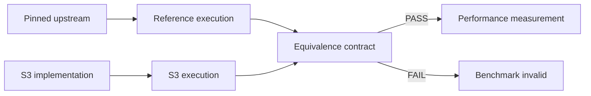

# S3 Language External Benchmarks

Public, reproducible benchmark and correctness harness for workloads implemented with the **S3 programming language**.

This repository is intentionally separate from the main S3 compiler repository so benchmark methodology, reference pins and result contracts can be inspected independently.

> **CORRECTNESS BEFORE PERFORMANCE.** A timing result is invalid unless the S3 implementation and the reference implementation satisfy the campaign's explicit observable-equivalence contract.

## Why this repository exists

Compiler benchmarks are easy to overstate. S3-Benchmarks uses a stricter model:

1. pin an external reference workload;
2. define the observable behavior that must match;
3. verify equivalence first;
4. only then collect performance measurements;
5. keep candidate workloads separate from executable benchmark claims.



## Executable workload

### [`benchmarks/jsmn`](benchmarks/jsmn/README.md)

Compares the upstream C implementation of `zserge/jsmn` with an S3 behavioral port kernel under a differential correctness contract.

## Candidate corpus

The post-M1.80 program tracks pinned external references for future campaigns:

- [`references/upstreams-m171-m180.json`](references/upstreams-m171-m180.json) — immutable upstream pins and milestone mapping;
- [`references/README.md`](references/README.md) — promotion policy for external workloads;
- [`candidates/m171-m180`](candidates/m171-m180/README.md) — bounded campaign candidates.

Current references include:

- Rust;
- Tokio;
- Mio;
- rustls;
- libuv;
- LLVM;
- Cargo;
- uv.

MoneyPrinterTurbo is tracked only as a possible real-world workload shape. It is **not** treated as a compiler oracle and is not vendored as an executable benchmark claim.

## Running the suite

```bash
# Differential correctness only
python tools/runner.py --verify-only

# Short benchmark smoke
python tools/runner.py --smoke

# Full statistical run
python tools/runner.py --full
```

At present these commands execute the **JSMN campaign**. Candidate campaigns are not benchmark results until they have their own correctness and structural-equivalence harnesses.

## Pinned S3-TISA V3 characterization

`tools/s3_tisa_v3_benchmark.py` characterizes one fixed arithmetic fixture
using the clean compiler and CPU V3 pins. It reports compile-only,
hosted-compile-and-execute, S3-to-TISA compile/lower/execute, and already-lowered
TISA-emulator-only samples as separate distributions, with raw nanosecond
samples, median, nearest-rank p95, result checks, source/artifact hashes, and
instruction/cycle counts. The report is `CHARACTERIZATION_ONLY`; it does not
claim a general speedup or compare unrelated targets. RTL, WASI, and native
measurements are explicitly marked as not run in this increment.

The saved 30-repeat run is
[`arithmetic-add-20261016.json`](reports/s3-tisa-v3/arithmetic-add-20261016.json)
(3 warmups, result 42, 22 instructions, 122 TISA bytes). On its recorded host,
median compile-only time was 2.458 ms, hosted compile+execute 3.013 ms,
S3-to-TISA compile/lower/execute 306.376 ms, and already-lowered emulator-only
execution 1.035 ms. These phases have different scope; the numbers are not a
speedup comparison. The full suite passes with 59 tests, one optional skip, and
three subtests. Two Windows-only historical replay hash failures exposed by the
initial run are fixed by normalizing only CRLF-to-LF when validating raw JSON;
the archived experiment files themselves remain unchanged.

```powershell
python tools/s3_tisa_v3_benchmark.py `
  --compiler-root C:\path\to\clean-compiler-2eab8a43 `
  --cpu-v3-root C:\path\to\clean-cpu-v3 `
  --report reports\s3-tisa-v3\run.json `
  --warmups 3 --repetitions 30
```

## Pinned S3 candidate matrices

`tools/s3_112_candidate_matrix.py` accepts a JSON specification with an exact
control revision, one or more exact candidate revisions/configurations, and a
workload/protocol selection. Each variant is checked out and compiled in a
separate clean source tree. The runner verifies source/reference identity,
native output equality, independently inspected ELF structure, and paired
interleaved timing. It refuses to reuse evidence directories. Timing output is
always `CHARACTERIZATION_ONLY`; it does not make a speedup claim.

The `control` object and each entry in `candidates` use this shape:

```json
{
  "id": "BASE",
  "revision": "<full lowercase Git SHA>",
  "optimization": "O1",
  "native_policy": "baseline",
  "instruction_budget_mode": "per-instruction"
}
```

The schema identifier is `s3.candidate-matrix.v1`; supported workload IDs,
compiler options and timing fields are validated fail-closed by the runner.
Run it on Linux x86-64 with new, disjoint work/evidence paths:

```bash
python tools/s3_112_candidate_matrix.py \
  --spec path/to/matrix.json \
  --work-root /tmp/s3-matrix-work-<id> \
  --output-dir /tmp/s3-matrix-evidence-<id>
```

The matrix can represent `BASE`, `A`, `B`, and `A+B` as separately pinned
source revisions or supported compiler configurations. Build and timing
execution are intentionally separate from the unit tests for the spec parser.

## Result validity

A result should be treated as valid only when all applicable checks pass:

- pinned reference identity;
- deterministic input corpus;
- semantic/observable equivalence;
- expected checksum/output;
- campaign-specific structural checks;
- successful benchmark harness completion.

A faster run with different observable behavior is a **failed compiler/workload comparison**, not a performance win.

## CI

`.github/workflows/tests.yml` executes verification for the currently supported executable suite on pushes and pull requests.

## Relationship to S3

The main S3 compiler project explores typed IR, verification, SSA/CFG, optimization, S3 Assembly and native Linux x86-64 generation.

This repository does not duplicate the compiler. Its role is to provide **external, auditable evidence** for workload correctness and performance characterization as S3 evolves.
